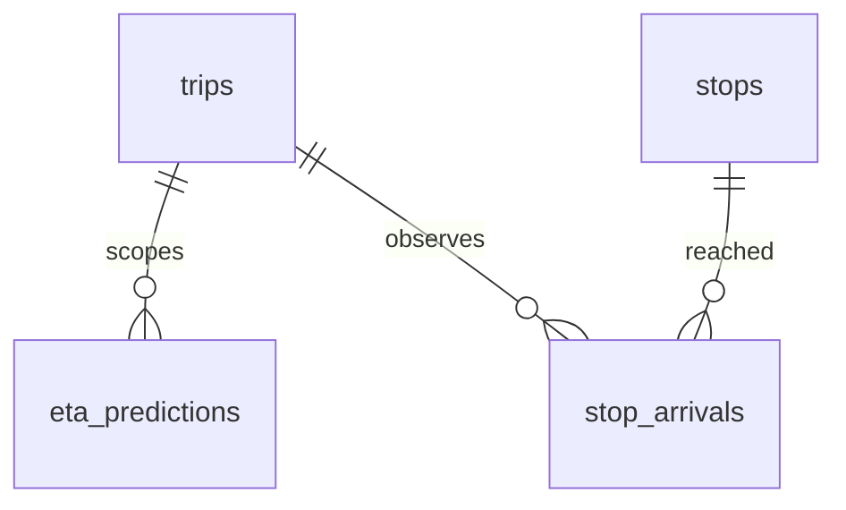
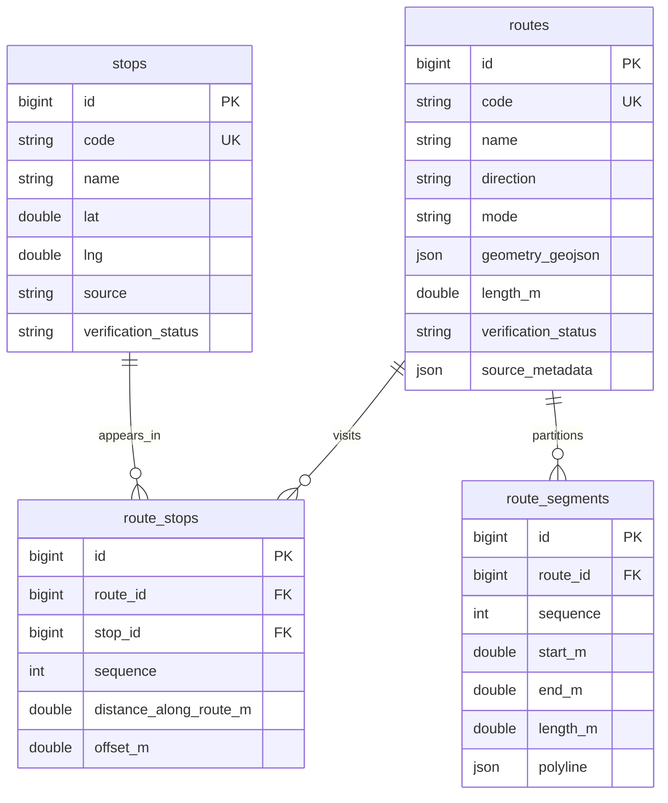
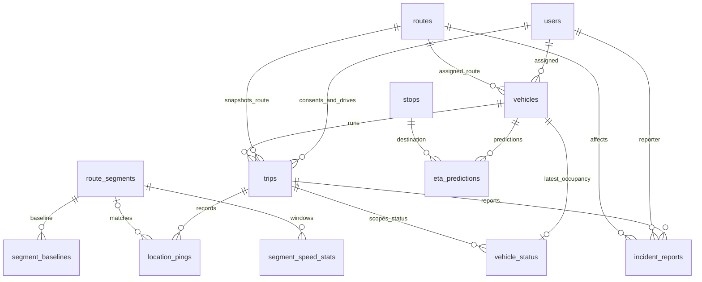

# Entity relationship model

Phase 4 adds nullable `eta_predictions.trip_id` (legacy rows cannot safely be assigned to a trip), paired `naive_arrival_at`, JSON context and `actual_arrival_source`. New rows always have trip identity. `stop_arrivals` has a unique `(trip_id, stop_id)` with GPS-derived arrival time/source and a simulation flag. This pilot assumes one visit per stop ID per trip; repeated visits require a future sequence/visit identity extension before loop routes can be evaluated safely. Speed snapshots gain `computed_at`; baselines gain `day_count` and `computed_at`; pings gain a segment/source/recording-time index. Baseline/traffic computation and ETA logging are implemented in Phase 4.

Phase 0 installs the framework user, session, cache, job and Sanctum token tables. Phase 1 adds route geometry/stops/segments. Phase 2 adds driver ingestion and the remaining starting-model tables; the local demonstration uses explicitly simulated data.

`routes.code` identifies a direction. Both link tables have unique `(route_id, sequence)` constraints. Stop IDs may appear at multiple sequences for repeated visits. Route deletion cascades to its links/segments; stop deletion is restricted while referenced. Coordinates are WGS84, GeoJSON `[longitude, latitude]`; API stop fields retain named `lat`/`lng`. Distances are spherical meters using mean Earth radius 6,371,008.8 m.

## Phase 2 relationships

- Users have constrained commuter/driver/admin roles and simulation markers. Public registration cannot choose admin or simulation identity.
- Trips snapshot driver/route IDs, consent time/version, battery endpoints and simulation status. Nullable unique `active_driver_id` and `active_vehicle_id` enforce at most one current trip for either identity; ending sets both to null.
- Pings have globally unique `client_ping_uuid`, a canonical-payload hash, UTC recording/receipt timestamps, quality offset/off-route flags and optional matched segment/distance. Off-route pings have no segment/distance assignment. Deleting a segment nulls its ping reference; import/build commands additionally prevent layout changes beneath trip history.
- Status has `vehicle_id` as its primary key and carries `trip_id` to prevent stale occupancy leaking into a new trip. Incidents derive reporter/route/trip and expiry server-side.
- Baseline/window uniqueness includes `is_simulated` so later engines can keep simulated and real observations separate. Phase 4 implements baseline/speed computation and trip-scoped ETA logging.
- Simulation flags extend route/stop/segment/link tables for the separate fictional demo. The demo's geometry and boarding points are not real pilot data.
