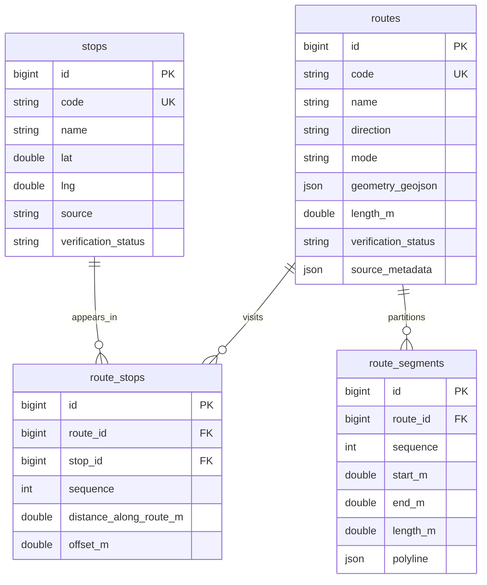

# Entity relationship model

Phase 0 installs the framework user, session, cache, job and Sanctum token tables. Phase 1 adds the transport data tables below; no vehicles or GPS pings exist yet.

`routes.code` identifies a direction. Both link tables have unique `(route_id, sequence)` constraints. Stop IDs may appear at multiple sequences for repeated visits. Route deletion cascades to its links/segments; stop deletion is restricted while referenced. Coordinates are WGS84, GeoJSON `[longitude, latitude]`; API stop fields retain named `lat`/`lng`. Distances are spherical meters using mean Earth radius 6,371,008.8 m.
